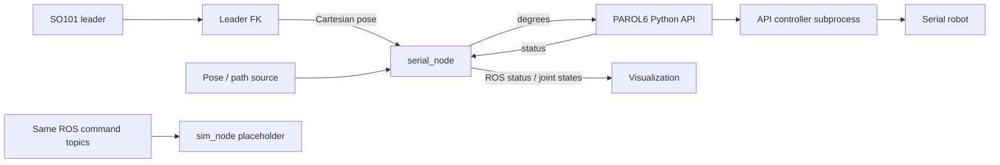

# Robot workspace — Python API experiment

This branch, `feature/python-api`, replaces the custom C++ runtime with the upstream PAROL6 Python API behind a ROS server. The previous implementation was committed as `d5d4954` on `basic` and merged into local `main` before this experiment.

## Packages

| Location | Responsibility |
| --- | --- |
| `src/robot_server/scripts/serial_node.py` | ROS command ownership, acknowledgements, unit conversion and hardware status |
| `external/robot_core/control/python_api.py` | Owns the PAROL6 API controller subprocess and async client |
| `src/robot_server/scripts/sim_node.py` | Inert runnable placeholder with the same command subscriptions; no application publications |
| `src/robot_teleop/scripts/so101.py` | SO101 leader ROS node |
| `src/robot_teleop/robot_teleop/leader_pose.py` | Application-specific encoder/frame/gripper mapping |
| `external/robot_core/kinematics` | Pinocchio model loading, FK and Jacobian IK; no ROS or robot API dependency |
| `external/robot_core/base`, `data` | Command interface and shared data types |
| `external/robot_core/control/mujoco.py` | Standalone MuJoCo execution of timed joint commands |
| `src/robot_server/robot_server_client` | Public ROS producer client and the move_joint CLI used by pose and standby |
| `src/robot_path` | Cartesian path planning and ROS path source |
| `src/robot_description` | Robot assets and profile factories |
| `src/model_client`, `src/robot_data` | Policy transport and offline dataset/training utilities |

Pinocchio reads URDF joint limits, joints and frames directly. `Chain` contains only model/layout data; FK is a function, and `PoseIK` owns solver scratch data, Jacobian updates and integration. No `UrdfModel` wrapper or second XML parser remains in the kinematics library.



## Configuration

- [Robot](external/robot_core/robot.toml) — PAROL6 port and API connection, joint profiles, pose, motion timing and ROS server defaults.
- [Teleop](src/robot_teleop/robot_teleop/teleop.toml) — leader port and calibration, frame mapping and profile selection. The Pixi teleop tasks select a profile by name.
- [Path](src/robot_path/robot_path/path.toml) — path geometry, sampling, Cartesian timing and display settings.

## Install and run

```sh
pixi install -e ros
pixi run -e ros setup-ros --build-only
```

In separate terminals, when ready to operate the physical robot:

```sh
pixi run server-parol6-serial
pixi run home
pixi run teleop
pixi run engage
```

Use `pixi run disengage` to pause. `pose` and `standby` upload timed API joint moves. `server-stop` stops the serial server and its API child; `server-parol6-serial restart:=true` fully restarts it. Teleop publishes the follower model and the end-effector goal for Foxglove. Start the bridge once with `pixi run foxglove`.

`pixi run server` starts the simulation placeholder. It accepts messages and does nothing: no motion, observations or status. The [standalone MuJoCo example](docs/reference/architecture.md#timed-joint-commands) runs the same pose command from Python. ROS simulation, recording and evaluation are deferred on this branch. Dataset preparation/training from existing recordings remain separate under `environments/models`.

See [serial architecture and limitations](src/robot_server/SERIAL.md), [teleop](src/robot_teleop/README.md), [path source](src/robot_path/README.md), and [kinematics](external/robot_core/kinematics/README.md).
