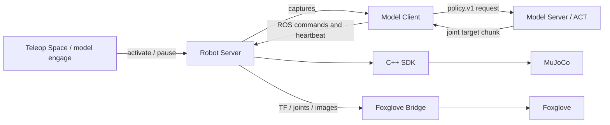

# Robot workspace

A ROS 2 Jazzy workspace for running a simulated robot, viewing its observations in
Foxglove, and connecting independent command producers such as ACT inference.
The C++23 SDK owns execution, control authority, IK, interpolation and backend
timing. It has no ROS dependency; the Robot Server exposes it through ROS.

This repository contains the source, robot meshes/scenes, build scripts and
locked environments needed for the walkthrough below. Learned model weights are
downloaded separately. No old workspace, private archive or cloud instance is
needed. Run all commands from the directory containing this README.

## What runs where

| Directory / process | Responsibility |
| --- | --- |
| `external/robot_runtime` | ROS-free C++ SDK and matching Python bindings (`Configuration`, `Robot`, `ControlSession`, `Observation`). |
| `src/robot_server` | Owns robot/backend/camera configuration, accepts commands, publishes observations and visualization topics. Its launch file includes Foxglove Bridge. |
| `src/model_client` | Reads captures, requests inference and submits timestamped joint targets. Requests activation through Robot Server; never controls the SDK directly. |
| `inference` | Protobuf/WebSocket model serving, processors and portable bundles; no ROS or robot connection. |
| `training` | Direct LeRobot training, configurations, datasets and training runs. |
| `src/robot_teleop` | SO101/keyboard teleoperation and demonstration collection. |
| `src/robot_bringup` | ROS launch files that compose the packages. |
| `scripts`, `environments/models` | Workspace setup/build tools and an isolated optional Torch/LeRobot environment. |
| `docs` | Tutorials, guides, API reference and developer notes. |



The Robot Server starts **disabled and without a selected producer**. Launching
ACT does not enable motion. Only explicit operator commands do that.

## 1. Clone and build

Supported environment targets are **Apple Silicon macOS** and **Linux x86_64**.
You need Git, curl, tar, internet access and space for several GB of dependencies.
On macOS install Apple's Command Line Tools (`xcode-select --install`) if they are
missing. Linux needs a working graphics driver/OpenGL stack for camera rendering;
a headless machine can use `MUJOCO_GL=egl` with an available EGL driver.
**Windows through WSL2 (Ubuntu x86_64) uses the Linux environment.** Follow the
[WSL2 setup guide](docs/guides/wsl.md), then this walkthrough. Native Windows,
Windows ARM64/WSL ARM64 and Intel macOS are not included in the environment locks.
WSL graphics and end-to-end operation still need verification on a Windows machine.

```sh
git clone https://github.com/marcusoberg/robot_ws.git
cd robot_ws
./scripts/setup.sh
```

Setup uses an existing Pixi installation, or installs Pixi in `.tools/` when it
is unavailable. To explicitly choose a workspace-local Pixi installation:

```sh
./scripts/setup.sh --local-pixi
```

Setup installs the root Pixi/RoboStack environment, pinned native dependencies,
the C++ SDK and bindings, then builds the six ROS packages listed above. It also
compiles an example against the installed C++ SDK. It does not start a robot or
model, and does not install Torch/LeRobot yet. No separate system ROS installation
or Conda activation is required.

After setup, enter a **fresh** workspace shell:

```sh
pixi shell
pixi run doctor
```

If Pixi was installed locally, enter with `.tools/pixi shell` instead. Inside that
shell the commands below still use `pixi`. Expect the doctor report to end with
`"errors": []`; it checks imports and installation paths, not robot operation.

Do this in **every new terminal** used below: change to your clone, then run
`pixi shell` (or `.tools/pixi shell`). Do not nest another environment or source a
different ROS workspace. On shells that auto-activate Conda, skip that activation
when `PIXI_IN_SHELL` is set.

## 2. Install model dependencies and fetch ACT

Once, from the activated workspace shell:

```sh
pixi run setup-models
pixi run fetch-act
```

The first command creates `environments/models/.venv` with locked LeRobot 0.6.0
and Torch 2.10.0 dependencies, separate from the ROS environment. The second
fetches approximately **207 MB** into `models/act-base/model`:

- Public model: [alexhegit/so101-simstudio-lab01-pnp-act-state6](https://huggingface.co/alexhegit/so101-simstudio-lab01-pnp-act-state6).
- Fixed revision: `a47afe4dad358031794505799307d4f9756f316c`.
- Six joint positions and three 640×480 RGB cameras, with a 0.05 s action period.
- Weights, model configuration, normalization processors and the upstream model card.
- No optimizer state or training dataset; no Hugging Face login is needed.

Every downloaded file is checked against the sizes and SHA-256 hashes in
[`act-public.json`](environments/models/act-public.json). Repeating the command
verifies existing files and fetches missing ones. It refuses to replace a file
whose hash differs. An offline check is also available:

```sh
pixi run fetch-act --check
```

This is the upstream trained ACT policy, not one of the historical 100-step local
fine-tunes. It is a starting point for simulation; upstream evaluation numbers
are not a measured success rate for this workspace. Weights and downloaded files
stay ignored by Git. The included model card identifies the upstream license.

## 3. Terminal A — simulated robot and Foxglove Bridge

```sh
ros2 launch robot_bringup so101_act.launch.py
```

Leave this terminal running. This starts the SO101 simulation, cameras and bridge.
It does not start a Model Server or Model Client by default.

In Foxglove, open a Foxglove WebSocket connection to **`ws://127.0.0.1:8766`**.
The Foxglove application itself is installed separately from this repository.
You can import the included [SO101 layout](src/robot_server/foxglove/so101_rgb3.json)
through Foxglove's layout import, or add panels manually. Useful panels/topics are:

| Panel / purpose | Topic or setting |
| --- | --- |
| 3D transforms | Fixed frame `world`; enable `/tf` and `/tf_static`. |
| Robot geometry | Add a URDF layer using `/robot/urdf`; package meshes are under `src/robot_server/assets` if your Foxglove version needs a local asset mapping. |
| Camera images | `/robot/cameras/front/rgb`, `/robot/cameras/top/rgb`, `/robot/cameras/wrist/rgb`. These show the cube, box and arm. |
| Joint position plots | `/joint_states` (measured) and `/robot/reference` (commanded). |
| Tracking | `/robot/tracking_error`. |
| Ownership/status | Raw Messages panels for `/robot/ownership` and `/robot/state`. |

The cameras provide the complete simulated scene. The URDF/TF view represents the
robot and coordinate frames. The initial status should be disabled/unselected.

## 4. Terminal B — ACT Model Server

Choose a device explicitly: use `mps` on Apple Silicon, `cuda` on a Linux NVIDIA
machine with a compatible driver, or `cpu` as a slower fallback. The command below
uses Apple Silicon:

```sh
pixi run model-server --model act \
  --checkpoint models/act-base/model \
  --features src/model_client/config/act.features.json \
  --revision a47afe4dad358031794505799307d4f9756f316c \
  --device mps --offline
```

Wait for **`Policy ready: ws://127.0.0.1:8000 (policy.v1)`**, then leave it running.
`--offline` refers to model loading after the fetch; initial setup/downloads need
internet access. Port 8000 serves predictions. Port 8766 is the separate Foxglove
connection. Both servers bind to localhost by default.

## 5. Terminal C — check inference, then start the Model Client

With terminals A and B running:

```sh
pixi run smoke inference --config src/model_client/config/act.yaml
```

Expect `"finite": true` and `"motion_sent": false`, with a report under
`runs/manual-inference-*`. This requests a prediction from an actual robot capture;
it deliberately does not command motion. Finite predictions alone do not prove
that the model can complete the task.

Then, in the same terminal:

```sh
ros2 launch model_client client.launch.py
```

Leave it running. It advertises the producer name `model`, sends heartbeats and
waits for `/model/engage` activation before submitting motion.

## 6. Terminal D — watch results before enabling motion

```sh
ros2 topic echo /robot/result
```

Keep this terminal open **before** running the commands in terminal E. The echo
command keeps running, and starting it afterwards can miss the control events.

## 7. Terminal E — activate ACT

```sh
ros2 service call /model/engage std_srvs/srv/SetBool '{data: true}'
```

The Model Client requests activation directly from Robot Server. The server enables
and acquires its native session; another producer is never taken over. The service
acknowledges submission; wait for `Active` in the Model Client log and inspect
`/robot/result` for actual outcomes.

## 8. Stop and repeat

```sh
ros2 service call /model/engage std_srvs/srv/SetBool '{data: false}'
```

Wait for `Paused; robot holds position`, then Ctrl+C the launch processes.
Restart the server for a fresh scene and activate explicitly again.

For SO101 teleoperation, launch `robot_teleop so101_parol6.launch.py` with the leader
port and tap Space in its terminal. See [teleop controls](src/robot_teleop/README.md).

## Troubleshooting

| Symptom | What to check |
| --- | --- |
| `ros2: command not found` | Enter a fresh Pixi shell from this clone. Check `command -v python` and `command -v ros2`; both should resolve inside its `.pixi/envs/default`. Ensure shell startup does not activate Conda over Pixi. |
| `Robot state unavailable` | Keep terminal A running, activate the same workspace in every terminal, use `--timeout 30`, and check `ROS_DOMAIN_ID` (the workspace sets 42). |
| `ConnectionRefusedError` on port 8000 | Start terminal B and wait for `Policy ready` before requesting inference. |
| Sources are listed but the robot does not move | Check the model activation result, camera updates, terminal B/C errors and `/robot/result` rejection reasons. Heartbeats alone do not start motion. |
| Cameras stop after reset | Stop/disable, restart server and client, and run the sequence again. |
| CUDA/MPS unavailable | Choose a device present on that computer. CPU is supported but slower inference can cause late predictions to be rejected. |
| Headless Linux renderer fails | Set `export MUJOCO_GL=egl` in terminal A before launching, with a working EGL driver installed. |
| A port is in use | Stop your earlier launch/server before starting a replacement. Run one model client for this walkthrough. |

## Development, recording and training

After source changes, run `pixi run build`, then open fresh Pixi shells.
Builds default to two compiler jobs and one ROS package at a time. For a small
WSL VM use `./scripts/setup.sh --local-pixi --jobs 1`, or rebuild with
`pixi run build --jobs 1`. The native extension is imported during setup to catch
shared-library/ABI errors before the ROS build. The [Linux build workflow](.github/workflows/linux-build.yml)
checks C++ compilation, Python bindings, the installed consumer and ROS imports;
it does not start robots, render cameras, fetch models or run training.
Generated files live in `build/`, `install/`, `log/`, `.workspace/` and `.pixi/`.
Colcon is passed explicit paths to the six maintained ROS packages; it does not
scan old repositories or archives. The fresh SDK is ordinary tracked source,
not a Git submodule.

- [Package/process/topic map](docs/reference/architecture.md)
- [SDK reference](docs/reference/sdk.md) and [command interface](docs/reference/commands.md)
- [Recording and export](docs/tutorials/03-record-and-export.md)
- [Remote inference over a manually created SSH tunnel](docs/guides/remote-inference.md)
- [Remote model/training guide](docs/guides/remote-models.md)
- [Developer qualification notes](docs/development/manual-qualification.md)

Recording/export currently requires fixed simulation intervals. Physical hardware,
physical camera transport, irregular live resampling and MPS training remain
unqualified. The existing training wrapper is a **100-step pipeline smoke tool**,
not a recommended full training recipe. Some historical documentation refers to
private preserved recordings/checkpoints; those sections are explicitly labeled
and are not prerequisites for this ACT walkthrough.

Local `models/`, `runs/`, `artifacts/`, `archive/`, legacy source folders, private
connection details, editor state and environments are excluded by `.gitignore`.
The original `src/parol6_demo` is left untouched if present and is not part of this
repository. Simulation meshes are included because the robot needs them; learned
model weights are not. See [third-party notices](THIRD_PARTY_NOTICES.md) for asset
attribution.
