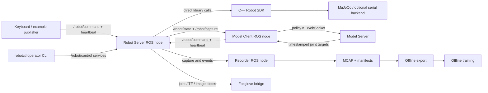

# Packages, processes and messages

The C++ SDK owns execution, control authority, IK, interpolation, numerical admission and backend timing. Python exposes the same native interface. The typed core does not choose a host clock or import ROS.

The Robot Server translates ROS messages into native requests and publishes native observations. Selection is explicit. A producer heartbeat can renew an already selected session; it cannot enable or select the producer.

Model Client selects named cameras/joints, supplies text/context, and publishes raw model targets. Native preparation fits their original timestamps. The Model Server knows features and checkpoint identity; it has no robot connection.

The recorder receives captures without episode labels, assigns its current episode, and owns completion/approval. It never blocks the Robot Server. Fixed-step collection callers wait for written acknowledgements between explicit steps.

Launch composition lives in `robot_bringup`. `robot_server/launch/server.launch.py` includes Foxglove. A launch command starts processes; enable, source selection and recording start remain explicit operator actions.

`recording_tools` reads historical MCAP schemas as well as new recordings. `model_api` owns only the model transport and feature contract. Neither the SDK nor Model Server depends on recording implementation.

The Robot Server package also owns the ROS interface helper `robot_server_client`. It handles producer identity/envelopes and heartbeats only. Independent producers depend on the interface owner; production code has no dependency on `robot_examples`.
