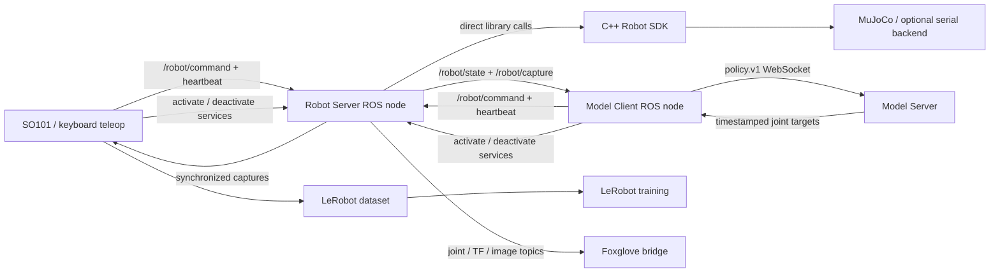

# Packages, processes and messages

The C++ SDK owns execution, control authority, IK, interpolation, numerical admission and backend timing. Python exposes the same native interface. The typed core does not choose a host clock or import ROS.

The Robot Server translates ROS messages into native requests and publishes native observations. Producer activation is explicit; the server enables and acquires native authority as one request. A producer heartbeat can renew an already selected session; it cannot enable or select the producer.

Model Client selects named cameras/joints, supplies text/context, and publishes raw model targets. Native preparation fits their original timestamps. The Model Server knows features and checkpoint identity; it has no robot connection.

The SO101 teleop node owns episode start/save/discard and writes through a LeRobot worker. It waits for written frame acknowledgements between explicit simulation steps.

Launch composition lives in `robot_bringup`. `robot_server/launch/server.launch.py` includes Foxglove. A launch command starts processes; Space or an engage service activates a producer through Robot Server. Recording starts separately.

`inference` owns the Protobuf/WebSocket model transport and feature contract. Neither the SDK nor Model Server depends on recording implementation.

The Robot Server package also owns the ROS interface helper `robot_server_client`. It handles producer envelopes, heartbeats and asynchronous activation results. Producers call the server directly; there is no operator CLI package.
